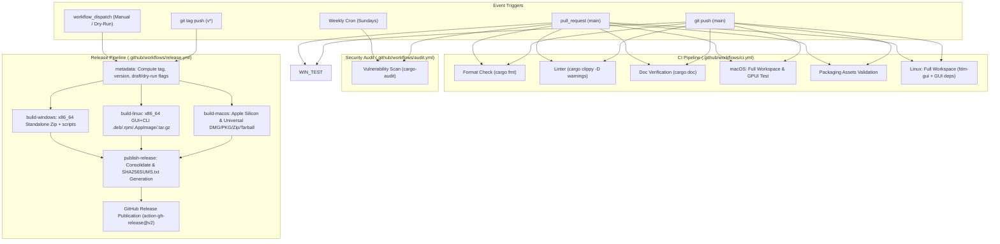

# Ferrite DM — CI/CD Pipeline & Release Engineering Guide

This document provides a comprehensive technical overview of the Continuous Integration (CI), Security Auditing, and Automated Release (CD) pipelines for **Ferrite DM**. It serves as an authoritative guide for contributors, maintainers, and security auditors.

---

## Table of Contents

1. [Architecture & Pipeline Overview](#1-architecture--pipeline-overview)
   - [Event Triggers & Lifecycle Flow](#event-triggers--lifecycle-flow)
   - [Concurrency Management](#concurrency-management)
   - [Permissions & Least Privilege Security Model](#permissions--least-privilege-security-model)
2. [Workflow Breakdown](#2-workflow-breakdown)
   - [Continuous Integration (`ci.yml`)](#continuous-integration-ciyml)
   - [Security Audit (`audit.yml`)](#security-audit-audityml)
   - [Automated Release Pipeline (`release.yml`)](#automated-release-pipeline-releaseyml)
3. [Local Pre-Flight Checklist for Contributors](#3-local-pre-flight-checklist-for-contributors)
   - [Standard Hygiene Checks](#standard-hygiene-checks)
   - [Local Packaging Verification](#local-packaging-verification)
   - [Automated Pre-Commit Hooks](#automated-pre-commit-hooks)
4. [Release Engineering Guide (Maintainers)](#4-release-engineering-guide-maintainers)
   - [Release Versioning Scheme](#release-versioning-scheme)
   - [Cutting a Release via Git Tag](#cutting-a-release-via-git-tag)
   - [Manual Trigger via Workflow Dispatch](#manual-trigger-via-workflow-dispatch)
   - [Release Asset Specifications](#release-asset-specifications)
5. [Verification & Installation Guide (Users & Admins)](#5-verification--installation-guide-users--admins)
   - [Verifying Checksums (SHA-256)](#verifying-checksums-sha-256)
   - [macOS Code Signature & Gatekeeper Inspection](#macos-code-signature--gatekeeper-inspection)
   - [Installation Procedures](#installation-procedures)
6. [Configuration, Secrets & Environment Requirements](#6-configuration-secrets--environment-requirements)
   - [GitHub Actions Permissions & Tokens](#github-actions-permissions--tokens)
   - [Environment Variables](#environment-variables)
   - [Future Code Signing & Notarization Roadmap](#future-code-signing--notarization-roadmap)
7. [Troubleshooting Common CI/CD Errors](#7-troubleshooting-common-cicd-errors)

---

## 1. Architecture & Pipeline Overview

Ferrite DM employs a multi-tiered GitHub Actions infrastructure designed to enforce code hygiene, guarantee cross-platform compatibility, detect supply-chain vulnerabilities, and produce cryptographically verifiable release artifacts.

### Event Triggers & Lifecycle Flow



| Pipeline | Trigger Events | Purpose | Execution Scope |
| :--- | :--- | :--- | :--- |
| **CI** (`ci.yml`) | `push` to `main`, `pull_request` against `main`, manual dispatch | Quality gate: formatting, linting, tests, documentation, packaging sanity | Multi-platform matrix (`macos-latest`, `ubuntu-latest`, `windows-latest`) |
| **Security Audit** (`audit.yml`) | Weekly cron schedule (`0 0 * * 0`), `pull_request` modifying `Cargo.*`, pushes, manual dispatch | Supply-chain security: scans dependencies against RustSec Advisory Database | `ubuntu-latest` running `rustsec/audit-check@v2` |
| **Release** (`release.yml`) | `push` of tags matching `v*`, manual `workflow_dispatch` (with dry-run/draft/prerelease flags) | Production builds: compiles binaries, packages installers, calculates unified SHA256, drafts release | Decoupled matrix (`macos-latest`, `ubuntu-latest`, `windows-latest`) |

### Concurrency Management

All workflows implement concurrency cancellation groups to optimize runner usage and prevent release race conditions:

- **CI Pipeline (`ci.yml`) & Security Audit (`audit.yml`):**
  ```yaml
  concurrency:
    group: ${{ github.workflow }}-${{ github.ref }}
    cancel-in-progress: true
  ```
  When a developer pushes new commits to an active pull request, outdated test runs are instantly cancelled.

- **Release Pipeline (`release.yml`):**
  ```yaml
  concurrency:
    group: ${{ github.workflow }}-${{ github.ref_name || github.ref }}
    cancel-in-progress: false
  ```
  In-flight release builds are **never cancelled** midway, protecting tag deployments from race conditions or partial asset publication.

### Permissions & Least Privilege Security Model

Ferrite DM enforces the principle of least privilege across all workflows:

- **CI & Security Audit:** Read-only repository access (`permissions: { contents: read }`). Jobs cannot modify git trees, open PRs, or alter GitHub Releases.
- **Release Pipeline:** Write permissions scoped strictly to release asset publishing (`permissions: { contents: write }`).

---

## 2. Workflow Breakdown

### Continuous Integration (`ci.yml`)

The primary quality gate defined in [.github/workflows/ci.yml](file:///.github/workflows/ci.yml) validates every proposed change. It is partitioned into targeted jobs:

#### 1. Code Hygiene & Formatting (`fmt`)
- **Runner:** `ubuntu-latest`
- **Command:** `cargo fmt --all -- --check`
- **Goal:** Ensures zero whitespace or style drift across all 10 workspace crates.

#### 2. Static Analysis & Linting (`clippy`)
- **Runner:** `ubuntu-latest`
- **Linux GUI Deps Installed:** `cmake pkg-config libssl-dev libx11-dev libxkbcommon-dev libxkbcommon-x11-dev libwayland-dev libfontconfig1-dev libasound2-dev libpulse-dev`
- **Command:** `cargo clippy --workspace --all-targets -- -D warnings`
- **Goal:** Catches common anti-patterns, redundant clones, logic issues, and performance regressions across 100% of workspace targets (including the GPUI desktop application on Linux). Any compiler or linter warning fails the job.

#### 3. Documentation Build (`doc`)
- **Runner:** `ubuntu-latest`
- **Linux GUI Deps Installed:** Same as above.
- **Command:** `cargo doc --workspace --no-deps`
- **Goal:** Verifies that internal rustdoc comments compile cleanly without broken intra-doc links or syntax errors. Includes `fdm-gui` on Linux with GUI native library headers present.

#### 4. Multi-Platform Testing Matrix (`test`)
The test matrix accommodates crate-specific platform dependencies:

- **macOS (`macos-latest`):**
  - Runs full workspace verification: `cargo check --workspace` and `cargo test --workspace`.
  - Exercises the native GPUI desktop application (`crates/fdm-gui`), macOS sleep prevention APIs (`IOPMAssertionCreateWithName`), and Unix socket IPC.
  - **Packaging Assets Verification:** Validates script permissions (`chmod +x`), compiles the icon generator via `swift scripts/generate-icon.swift resources`, and verifies that [resources/Ferrite.icns](file:///resources/Ferrite.icns) and [resources/Info.plist](file:///resources/Info.plist) exist and are structurally sound.
- **Linux (`ubuntu-latest`):**
  - Installs required Linux GUI native libraries:
    ```
    cmake pkg-config libssl-dev libx11-dev libxkbcommon-dev libxkbcommon-x11-dev
    libwayland-dev libfontconfig1-dev libasound2-dev libpulse-dev
    ```
  - Runs full workspace compilation check and tests including `fdm-gui`:
    ```bash
    cargo check --workspace
    cargo test --workspace
    ```
  - **Linux Packaging Assets Verification:** Checks that all required files from `packager` are present and scripts are executable:
    ```bash
    test -f resources/linux/ferrite-dm.desktop
    test -f resources/linux/io.ferrite_dm.FerriteDM.metainfo.xml
    test -x scripts/package-linux-deb.sh
    test -x scripts/package-linux-rpm.sh
    test -x scripts/package-linux-appimage.sh
    ```
- **Windows:** Deferred / roadmap; cross-platform OS integration abstraction layer prepared in `fdm-core` and `fdm-ipc` for future enablement.

#### 5. Intelligent Caching (`rust-cache@v2`)
Workflows leverage `Swatinem/rust-cache@v2`, which hashes `Cargo.lock` and workspace configuration. This reduces average build durations from ~8 minutes down to under 90 seconds by persisting `target/` artifacts and `~/.cargo/registry/index`.

---

### Security Audit (`audit.yml`)

Supply chain security is managed by [.github/workflows/audit.yml](file:///.github/workflows/audit.yml):

- **Trigger:** Scheduled weekly every Sunday at 00:00 UTC, on pull requests modifying `Cargo.lock` or `Cargo.toml`, or via manual `workflow_dispatch`.
- **Tooling:** Runs `cargo-audit` backed by the [RustSec Advisory Database](https://rustsec.org).
- **Behavior:**
  - Scans the dependency graph for known security advisories (CVEs, RUSTSEC IDs).
  - Flags unmaintained crates or yanked versions.
  - Generates clear annotations in the GitHub Actions summary if vulnerable packages are found.

---

### Automated Release Pipeline (`release.yml`)

The production release workflow in [.github/workflows/release.yml](file:///.github/workflows/release.yml) is structured as a decoupled multi-stage deployment pipeline: `metadata` -> parallel multi-platform compilation & packaging -> consolidated checksum generation & `publish-release`.

#### Matrix Target Matrix

| Operating System | Target Architecture | Compiler Target(s) | Artifacts Produced |
| :--- | :--- | :--- | :--- |
| **macOS (Apple Silicon)** | `arm64` | `aarch64-apple-darwin` | `Ferrite-DM-<ver>-macos-arm64.{dmg,pkg,zip}`, `ferrite-dm-<ver>-macos-arm64.tar.gz` |
| **macOS (Universal)** | `arm64` + `x86_64` | `aarch64-apple-darwin`, `x86_64-apple-darwin` | `Ferrite-DM-<ver>-macos-universal.{dmg,pkg,zip}`, `ferrite-dm-<ver>-macos-universal.tar.gz` |
| **Linux** | `x86_64` | `x86_64-unknown-linux-gnu` | `ferrite-dm-<ver>-linux-x86_64.{tar.gz,.deb,.rpm,.AppImage}` |
| **Windows** | `x86_64` | `x86_64-pc-windows-msvc` | `ferrite-dm-<ver>-windows-x86_64.zip` |

#### Pipeline Stages

1. **Stage 1: Metadata Preparation (`metadata`)**
   - Parses the git reference (`v*`) or inputs supplied via `workflow_dispatch`.
   - Computes canonical `version` string (stripping `v` prefix) and `tag_name`.
   - Detects pre-release status based on semver tags (e.g. `-alpha`, `-beta`, `-rc`) or explicit input.
   - Evaluates `dry_run` and `draft` configuration flags.

2. **Stage 2: Parallel Multi-Platform Compilation & Packaging**
   - **macOS Matrix (`build-macos`)**:
     - Builds native release binaries: `fdm-gui` (GPUI app), `ferrite-dm` (CLI/daemon), and `ferrite-native-host`.
     - Supports both Apple Silicon native and Universal (`lipo` multi-architecture binary consolidation).
     - Generates icon sets via [scripts/generate-icon.swift](file:///scripts/generate-icon.swift).
     - Assembles `Ferrite DM.app` with ad-hoc codesigning (`codesign --force --deep --sign -`).
     - Packages `.dmg` drag-and-drop disk image via `hdiutil`.
     - Packages `.pkg` flat installer with postinstall script via `pkgbuild`.
     - Bundles standalone `.zip` and CLI portable `.tar.gz` with [scripts/install-cli.sh](file:///scripts/install-cli.sh).
   - **Linux Builder (`build-linux`)**:
     - Installs required Linux GUI native libraries: `cmake pkg-config libssl-dev libx11-dev libxkbcommon-dev libxkbcommon-x11-dev libwayland-dev libfontconfig1-dev libasound2-dev libpulse-dev`.
     - Compiles all three binaries: `fdm-gui` (GPUI desktop app), `ferrite-dm` (CLI/daemon), and `ferrite-native-host`.
     - Runs four parallel packaging steps via dedicated scripts:
       - **`.deb`** via `scripts/package-linux-deb.sh`: Debian-compliant archive targeting `amd64` with `DEBIAN/control` metadata, `libc6`, `libssl3`, `libx11-6`, `libwayland-client0`, `libxkbcommon0` dependencies, desktop entry, hicolor icon hierarchy, and `postinst`/`postrm` hooks running `update-desktop-database` and `gtk-update-icon-cache`.
       - **`.rpm`** via `scripts/package-linux-rpm.sh`: Builds from [resources/linux/ferrite-dm.spec](file:///resources/linux/ferrite-dm.spec) with Fedora/RHEL/openSUSE-compatible `BuildRequires`, runtime `Requires`, and `%post`/`%postun` scriptlets.
       - **`.AppImage`** via `scripts/package-linux-appimage.sh`: Self-contained universal executable bundling the application, desktop entry, and icon hierarchy in AppDir format, deployable on any x86_64 Linux.
       - **Standalone `.tar.gz`**: Contains `fdm-gui`, `ferrite-dm`, `ferrite-native-host`, `install.sh`, `uninstall.sh`, README, and licenses for direct extraction and manual install.
   - **Windows Builder (`build-windows`)**:
     - Compiles `fdm-cli` and `fdm-native-host` on `windows-latest` via MSVC.
     - Packages standalone ZIP archive with PowerShell installers (`install.ps1`, `uninstall.ps1`), Command Prompt wrappers (`install.bat`, `uninstall.bat`), README, and licenses.

3. **Stage 3: Unified Checksums & Publication (`publish-release`)**
   - Uses `actions/download-artifact@v4` with `merge-multiple: true` to consolidate all platform assets into a unified directory.
   - Computes a master `SHA256SUMS.txt` cryptographic manifest across all release files.
   - Performs self-verification via `sha256sum -c SHA256SUMS.txt`.
   - **Dry Run Handling:** If `dry_run: true` was selected, prints the complete release manifest and skips publishing.
   - **Publishing:** Publishes via `softprops/action-gh-release@v2` with automated release notes and checksum verification instructions.

---

## 3. Local Pre-Flight Checklist for Contributors

Before committing and pushing code or opening a pull request, run the following local verification checks to ensure CI will pass cleanly.

### Standard Hygiene Checks

Run these commands from the repository root:

```bash
# 1. Format code check (fails if formatting is needed)
cargo fmt --all -- --check

# If formatting diffs are reported, format the workspace:
cargo fmt --all

# 2. Strict static analysis (warnings treated as fatal errors)
cargo clippy --workspace --all-targets -- -D warnings

# 3. Check workspace compilation
cargo check --workspace

# 4. Run workspace unit and integration tests
cargo test --workspace

# 5. Verify rustdoc generation
cargo doc --workspace --no-deps
```

### Linux GUI Build Prerequisites

To build, lint, and test the full workspace (including `fdm-gui`) on Linux, install the following native packages:

#### Debian / Ubuntu
```bash
sudo apt-get update
sudo apt-get install -y \
  cmake pkg-config libssl-dev \
  libx11-dev libxkbcommon-dev libxkbcommon-x11-dev \
  libwayland-dev libfontconfig1-dev \
  libasound2-dev libpulse-dev
```

#### Fedora / RHEL
```bash
sudo dnf install -y \
  cmake pkgconf-pkg-config openssl-devel \
  libX11-devel libxkbcommon-devel libxkbcommon-x11-devel \
  wayland-devel fontconfig-devel \
  alsa-lib-devel pulseaudio-libs-devel
```

#### Arch Linux
```bash
sudo pacman -Sy cmake pkgconf openssl \
  libx11 libxkbcommon wayland fontconfig alsa-lib libpulse
```

### Dependency Audit Check

Ensure you have `cargo-audit` installed locally to test for vulnerable dependencies:

```bash
# Install cargo-audit (once)
cargo install cargo-audit --locked

# Audit workspace dependencies
cargo audit
```

### Local Packaging Verification

On macOS, you can test the packaging pipeline locally without performing a full rebuild:

```bash
# Verify icon generation and script permissions
chmod +x scripts/*.sh scripts/*.swift resources/pkg-scripts/*
swift scripts/generate-icon.swift resources

# Test packaging with pre-existing release binaries
cargo build --release -p fdm-gui -p fdm-cli -p fdm-native-host
./scripts/package-macos.sh --skip-build
```

### Automated Pre-Commit Hooks

To automatically prevent non-compliant commits from being committed, you can create a Git pre-commit hook in `.git/hooks/pre-commit`:

```bash
cat << 'EOF' > .git/hooks/pre-commit
#!/bin/bash
set -e

echo "==> Running local pre-flight checks..."
cargo fmt --all -- --check
cargo clippy --workspace --all-targets -- -D warnings
cargo test --workspace
echo "==> Pre-flight checks passed!"
EOF

chmod +x .git/hooks/pre-commit
```

---

## 4. Release Engineering Guide (Maintainers)

### Release Versioning Scheme

Ferrite DM adheres to [Semantic Versioning 2.0.0](https://semver.org/):

- **Major (`v1.0.0`):** Incompatible API changes, major protocol overhauls, or breaking database schema migrations.
- **Minor (`v0.2.0`):** Backwards-compatible new features (e.g., new protocol engine, UI tabs, browser integrations).
- **Patch (`v0.1.2`):** Backwards-compatible bug fixes, performance optimizations, or documentation revisions.

### Cutting a Release via Git Tag

1. **Synchronize Main Branch:** Ensure your local branch is up to date:
   ```bash
   git checkout main
   git pull origin main
   ```

2. **Update Version Numbers:** Update the workspace package version in [Cargo.toml](file:///Cargo.toml):
   ```toml
   [workspace.package]
   version = "0.1.2"
   ```
   Update the lockfile:
   ```bash
   cargo check --workspace
   ```

3. **Commit and Tag:**
   ```bash
   git add Cargo.toml Cargo.lock
   git commit -m "chore(release): prepare v0.1.2"
   git tag -a v0.1.2 -m "Release v0.1.2"
   ```

4. **Push to GitHub:**
   ```bash
   git push origin main
   git push origin v0.1.2
   ```

> [!IMPORTANT]
> Pushing a tag prefixed with `v` (e.g. `v0.1.2`) automatically triggers the production release pipeline in [.github/workflows/release.yml](file:///.github/workflows/release.yml).

### Manual Trigger via Workflow Dispatch

Maintainers can trigger a manual or dry-run release directly from the GitHub web UI or GitHub CLI:

```bash
gh workflow run release.yml \
  -f tag_name="v0.1.2" \
  -f dry_run=false
```

### Release Asset Specifications

Every official release produces the following assets:

| Artifact Name | Platform | Description |
| :--- | :--- | :--- |
| `Ferrite-DM-<version>-macos-arm64.dmg` | macOS (Apple Silicon) | Drag-and-drop Disk Image containing `Ferrite DM.app` and `/Applications` link. |
| `Ferrite-DM-<version>-macos-arm64.pkg` | macOS (Apple Silicon) | Flat installer package deploying to `/Applications` with postinstall permissions setup. |
| `Ferrite-DM-<version>-macos-arm64.zip` | macOS (Apple Silicon) | Compressed `Ferrite DM.app` bundle for direct extraction. |
| `ferrite-dm-<version>-macos-arm64.tar.gz` | macOS (Apple Silicon) | Portable archive with `fdm-gui`, `ferrite-dm`, `ferrite-native-host`, and installation scripts. |
| `Ferrite-DM-<version>-macos-universal.dmg` | macOS (Universal) | Universal Disk Image (runs natively on Apple Silicon & Intel x86_64). |
| `Ferrite-DM-<version>-macos-universal.pkg` | macOS (Universal) | Universal flat installer package for system-wide deployment. |
| `Ferrite-DM-<version>-macos-universal.zip` | macOS (Universal) | Universal compressed `Ferrite DM.app` bundle. |
| `ferrite-dm-<version>-macos-universal.tar.gz` | macOS (Universal) | Universal portable CLI & GUI archive. |
| `ferrite-dm-<version>-linux-x86_64.tar.gz` | Linux (x86_64) | Standalone tarball with `fdm-gui`, `ferrite-dm`, `ferrite-native-host`, `install.sh`, `uninstall.sh`, README, and licenses. |
| `ferrite-dm-<version>-linux-x86_64.deb` | Linux / Debian & Ubuntu | Native `.deb` package installable via `dpkg -i` or `apt install`. Includes desktop entry, AppStream metadata, hicolor icons, and `postinst`/`postrm` hooks. |
| `ferrite-dm-<version>-linux-x86_64.rpm` | Linux / Fedora, RHEL, openSUSE | Native `.rpm` package installable via `dnf`, `yum`, or `zypper`. Built from the RPM spec at `resources/linux/ferrite-dm.spec`. |
| `ferrite-dm-<version>-linux-x86_64.AppImage` | Linux (Universal x86_64) | Self-contained executable running on any x86_64 Linux with FUSE or AppImage runtime (glibc ≥ 2.31). No installation required. |
| `ferrite-dm-<version>-windows-x86_64.zip` | Windows (x86_64) | Standalone archive with `ferrite-dm.exe`, `ferrite-native-host.exe`, and PowerShell / Batch installers. |
| `SHA256SUMS.txt` | All | Master cryptographic checksum manifest containing SHA-256 hashes of all release files. |

---

## 5. Verification & Installation Guide (Users & Admins)

### Verifying Checksums (SHA-256)

Always verify the integrity and authenticity of downloaded binaries before executing or installing them.

#### macOS and Linux
1. Download the desired release asset and `SHA256SUMS.txt` from the GitHub Releases page into the same folder.
2. In terminal, run:
   ```bash
   # On macOS
   shasum -a 256 -c SHA256SUMS.txt --ignore-missing

   # On Linux
   sha256sum --check SHA256SUMS.txt --ignore-missing
   ```
3. Ensure the output confirms `OK`:
   ```text
   Ferrite-DM-0.1.1-macos-arm64.dmg: OK
   ```

#### Windows (PowerShell)
```powershell
Get-FileHash -Algorithm SHA256 .\ferrite-dm-0.1.1-windows-x86_64.zip
```
Compare the resulting hash with the corresponding entry in `SHA256SUMS.txt`.

---

### macOS Code Signature & Gatekeeper Inspection

Official macOS release builds are ad-hoc signed by default during open-source CI.

To verify the code signature:
```bash
codesign -dv --verbose=4 "/Applications/Ferrite DM.app"
```

Expected output:
```text
Executable=/Applications/Ferrite DM.app/Contents/MacOS/fdm-gui
Identifier=org.ferritedm.FerriteDM
Format=app bundle with generic
CodeDirectory v=20400 size=... flags=0x2(adhoc)
Signature=adhoc
```

> [!NOTE]
> If macOS Gatekeeper presents a security warning stating the app is from an unidentified developer upon first opening:
> 1. Right-click (or Control-click) `Ferrite DM.app` in Finder and select **Open**.
> 2. Click **Open** in the dialog prompt.
> 3. Alternatively, clear the quarantine attribute via terminal:
>    ```bash
>    xattr -cr "/Applications/Ferrite DM.app"
>    ```

---

### Installation Procedures

#### 1. macOS Disk Image (`.dmg`)
- Double-click the downloaded `.dmg` file (`Ferrite-DM-<version>-macos-arm64.dmg` or `universal.dmg`).
- Drag `Ferrite DM.app` into the `Applications` folder shortcut.
- Launch Ferrite DM from Spotlight or Launchpad.

#### 2. macOS Installer Package (`.pkg`)
- Double-click `Ferrite-DM-<version>-macos-*.pkg`.
- Follow the on-screen installer prompts. The postinstall script handles application placement and permissions.

#### 3. Linux Standalone Archive (`.tar.gz`)
Extract and execute the embedded installer script:
```bash
tar -xzf ferrite-dm-*-linux-x86_64.tar.gz
cd ferrite-dm-*
sudo ./install.sh
```
This installs `fdm-gui`, `ferrite-dm`, and `ferrite-native-host` into `/usr/local/bin` (or `~/.local/bin` if non-root).

#### 4. Linux Debian/Ubuntu Package (`.deb`)
```bash
sudo dpkg -i ferrite-dm-*-linux-x86_64.deb
# Or via apt for automatic dependency resolution:
sudo apt install ./ferrite-dm-*-linux-x86_64.deb
```

#### 5. Linux Fedora/RHEL/openSUSE Package (`.rpm`)
```bash
# Fedora / RHEL (dnf):
sudo dnf install ferrite-dm-*-linux-x86_64.rpm

# openSUSE (zypper):
sudo zypper install ferrite-dm-*-linux-x86_64.rpm
```

#### 6. Linux Universal AppImage (`.AppImage`)
```bash
chmod +x ferrite-dm-*-linux-x86_64.AppImage
./ferrite-dm-*-linux-x86_64.AppImage
```
No installation required. Runs on any x86_64 Linux with glibc ≥ 2.31. For persistent desktop integration, copy to `~/.local/bin` and register the `.desktop` file manually.

#### 7. Arch Linux (AUR)
Install from the AUR using an AUR helper:
```bash
yay -S ferrite-dm
# Or manually using the PKGBUILD:
git clone https://aur.archlinux.org/ferrite-dm.git
cd ferrite-dm
makepkg -si
```

#### 8. Windows Standalone Archive (`.zip`)
Extract the ZIP archive and run the installer:
- **Using PowerShell:**
  ```powershell
  Expand-Archive .\ferrite-dm-*-windows-x86_64.zip -DestinationPath .
  cd ferrite-dm-*
  .\install.ps1
  ```
- **Using Command Prompt:**
  ```cmd
  install.bat
  ```
This places the executables into `%LOCALAPPDATA%\FerriteDM\bin` (or `~/.ferrite-dm/bin`) and appends the directory to your User `PATH`.

#### 9. Register Browser Integration
After installing the binaries, register the WebExtension Native Messaging host for your installed browsers:
```bash
ferrite-dm native-host-install --browser all
```

---

## 6. Configuration, Secrets & Environment Requirements

### GitHub Actions Permissions & Tokens

The workflows rely on the default `GITHUB_TOKEN` automatically provisioned by GitHub Actions:

- **Settings in Repository:** Under **Settings > Actions > General > Workflow permissions**, select **Read and write permissions** (or specify individual permissions in workflow YAML as implemented).
- **Scope Used:**
  - `ci.yml`: `contents: read`
  - `audit.yml`: `contents: read`
  - `release.yml`: `contents: write` (for publishing releases and uploading build artifacts)

### Environment Variables

The CI and release environments configure the following standard environment variables:

| Variable | Recommended Value | Purpose |
| :--- | :--- | :--- |
| `CARGO_TERM_COLOR` | `always` | Forces colored ANSI output in GitHub Actions step logs. |
| `RUST_BACKTRACE` | `1` | Produces detailed backtraces if a unit test fails or panics. |
| `RUSTFLAGS` | `-D warnings` | Treats compilation warnings as fatal errors in CI checks. |

### Future Code Signing & Notarization Roadmap

For commercial or enterprise distributions requiring Apple Developer ID signing and Apple Notarization, the following GitHub Secrets can be introduced into [.github/workflows/release.yml](file:///.github/workflows/release.yml):

- `MACOS_CERTIFICATE_BASE64`: Base64-encoded `.p12` developer certificate.
- `MACOS_CERTIFICATE_PASSWORD`: Password for the exported `.p12` file.
- `APPLE_ID`: Apple developer account email.
- `APPLE_APP_SPECIFIC_PASSWORD`: Generated app-specific password for `notarytool`.
- `APPLE_TEAM_ID`: 10-character Apple Developer Team ID.

When configured, the packaging script executes:
```bash
xcrun notarytool submit "$DMG_PATH" --apple-id "$APPLE_ID" --password "$APPLE_APP_SPECIFIC_PASSWORD" --team-id "$APPLE_TEAM_ID" --wait
xcrun stapler staple "$DMG_PATH"
```

---

## 7. Troubleshooting Common CI/CD Errors

### 1. Clippy Warnings Treated as Errors
- **Error:** `error: aborting due to 1 previous error` during `cargo clippy`.
- **Cause:** CI runs with `-D warnings`. Any unused variable, missing lint annotation, or inefficient pattern triggers a build failure.
- **Fix:** Run `cargo clippy --workspace --all-targets` locally and resolve all flagged items before pushing.

### 2. Rustfmt Style Check Failure
- **Error:** `Diff in <file> at line X...` during `cargo fmt --all -- --check`.
- **Cause:** Code committed without standard rustfmt formatting.
- **Fix:** Run `cargo fmt --all` locally, stage the modified files, and amend or push a new commit.

### 3. Cargo Audit Flags a Vulnerability in a Transitive Dependency
- **Error:** `Crate: <name>, Version: <x.y.z>, Advisory: RUSTSEC-...`
- **Cause:** An indirect dependency has a published security advisory.
- **Fix:**
  - Check if a patched version is available: `cargo update -p <crate-name>`.
  - Re-run `cargo audit` locally.
  - If no patch exists yet and the vulnerability is unexploitable in Ferrite DM's architecture, document an exception in `.cargo/audit.toml` with a detailed rationale and review it with maintainers.

### 4. macOS Packaging Fails: `hdiutil create failed`
- **Error:** `hdiutil: create failed - Resource busy` or destination already exists.
- **Cause:** A stale DMG volume was previously mounted or `dist/` was not cleaned.
- **Fix:** Run `./scripts/package-macos.sh --clean` to wipe previous build stages.

### 5. Release Upload Fails with HTTP 403 / 404
- **Error:** `Resource not accessible by integration` during `action-gh-release`.
- **Cause:** Missing write permissions on `GITHUB_TOKEN`.
- **Fix:** Verify that [.github/workflows/release.yml](file:///.github/workflows/release.yml) declares `permissions: { contents: write }` at the root or job level.
