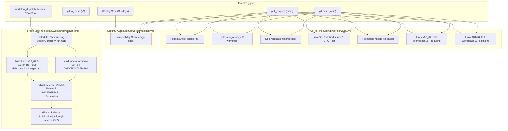

# Ferrite — CI/CD Pipeline & Release Engineering Guide

This document provides a comprehensive technical overview of the Continuous Integration (CI), Security Auditing, and Automated Release (CD) pipelines for **Ferrite**. It serves as an authoritative guide for contributors, maintainers, and security auditors.

---

## Table of Contents

1. [Architecture & Pipeline Overview](#1-architecture--pipeline-overview)
   - [Event Triggers & Lifecycle Flow](#event-triggers--lifecycle-flow)
   - [Concurrency Management](#concurrency-management)
   - [Permissions & Least Privilege Security Model](#permissions--least-privilege-security-model)
2. [Workflow Breakdown](#2-workflow-breakdown)
   - [Continuous Integration (`ci.yml`)](#continuous-integration-ciyml)
   - [Security Audit (`audit.yml`)](#security-audit-audityml)
   - [Automated Release Pipeline (`release.yml`)](#automated-release-pipeline-releaseyml)
3. [Local Pre-Flight Checklist for Contributors](#3-local-pre-flight-checklist-for-contributors)
   - [Standard Hygiene Checks](#standard-hygiene-checks)
   - [Local Packaging Verification](#local-packaging-verification)
   - [Automated Pre-Commit Hooks](#automated-pre-commit-hooks)
4. [Release Engineering Guide (Maintainers)](#4-release-engineering-guide-maintainers)
   - [Release Versioning Scheme](#release-versioning-scheme)
   - [Cutting a Release via Git Tag](#cutting-a-release-via-git-tag)
   - [Manual Trigger via Workflow Dispatch](#manual-trigger-via-workflow-dispatch)
   - [Release Asset Specifications](#release-asset-specifications)
5. [Verification & Installation Guide (Users & Admins)](#5-verification--installation-guide-users--admins)
   - [Verifying Checksums (SHA-256)](#verifying-checksums-sha-256)
   - [macOS Code Signature & Gatekeeper Inspection](#macos-code-signature--gatekeeper-inspection)
   - [Installation Procedures](#installation-procedures)
6. [Configuration, Secrets & Environment Requirements](#6-configuration-secrets--environment-requirements)
   - [GitHub Actions Permissions & Tokens](#github-actions-permissions--tokens)
   - [Environment Variables](#environment-variables)
   - [Future Code Signing & Notarization Roadmap](#future-code-signing--notarization-roadmap)
7. [Troubleshooting Common CI/CD Errors](#7-troubleshooting-common-cicd-errors)

---

## 1. Architecture & Pipeline Overview

Ferrite employs a multi-tiered GitHub Actions infrastructure designed to enforce code hygiene, guarantee cross-platform compatibility, detect supply-chain vulnerabilities, and produce cryptographically verifiable release artifacts.

### Event Triggers & Lifecycle Flow



| Pipeline | Trigger Events | Purpose | Execution Scope |
| :--- | :--- | :--- | :--- |
| **CI** (`ci.yml`) | `push` to `main`, `pull_request` against `main`, manual dispatch | Quality gate: formatting, linting, tests, documentation, packaging sanity | Multi-platform matrix (`macos-latest`, `ubuntu-latest`, `ubuntu-24.04-arm`) |
| **Security Audit** (`audit.yml`) | Weekly cron schedule (`0 0 * * 0`), `push` to `main`, `pull_request` against `main`, manual dispatch | Supply-chain security: scans dependencies against RustSec Advisory Database | `ubuntu-latest` installing `cargo-audit` via `taiki-e/install-action@cargo-audit` |
| **Release** (`release.yml`) | `push` of tags matching `v*`, manual `workflow_dispatch` (with dry-run/draft/prerelease flags) | Production builds: compiles binaries, packages installers, validates canonical names, calculates unified SHA256, publishes release | Decoupled matrix (`macos-latest` for `arm64` & `x86_64`, `ubuntu-latest` for Linux `x86_64`, `ubuntu-24.04-arm` for Linux `arm64`) |

### Concurrency Management

All workflows implement concurrency cancellation groups to optimize runner usage and prevent release race conditions:

- **CI Pipeline (`ci.yml`) & Security Audit (`audit.yml`):**
  ```yaml
  concurrency:
    group: ${{ github.workflow }}-${{ github.ref }}
    cancel-in-progress: true
  ```
  When a developer pushes new commits to an active pull request, outdated test runs are instantly cancelled.

- **Release Pipeline (`release.yml`):**
  ```yaml
  concurrency:
    group: ${{ github.workflow }}-${{ github.ref_name || github.ref }}
    cancel-in-progress: false
  ```
  In-flight release builds are **never cancelled** midway, protecting tag deployments from race conditions or partial asset publication.

### Permissions & Least Privilege Security Model

Ferrite enforces the principle of least privilege across all workflows:

- **CI & Security Audit:** Read-only repository access (`permissions: { contents: read }`). Jobs cannot modify git trees, open PRs, or alter GitHub Releases.
- **Release Pipeline:** Write permissions scoped strictly to release asset publishing (`permissions: { contents: write }`).

---

## 2. Workflow Breakdown

### Continuous Integration (`ci.yml`)

The primary quality gate defined in [.github/workflows/ci.yml](../.github/workflows/ci.yml) validates every proposed change. It is partitioned into targeted jobs:

#### 1. Code Hygiene & Formatting (`fmt`)
- **Runner:** `ubuntu-latest`
- **Command:** `cargo fmt --all -- --check`
- **Goal:** Ensures zero whitespace or style drift across all 10 workspace crates.

#### 2. Static Analysis & Linting (`clippy`)
- **Runner:** `ubuntu-latest`
- **Linux GUI Deps Installed:** `cmake pkg-config libssl-dev libx11-dev libxkbcommon-dev libxkbcommon-x11-dev libwayland-dev libfontconfig1-dev libasound2-dev libpulse-dev`
- **Command:** `cargo clippy --workspace --all-targets -- -D warnings`
- **Goal:** Catches common anti-patterns, redundant clones, logic issues, and performance regressions across 100% of workspace targets (including the GPUI desktop application on Linux). Any compiler or linter warning fails the job.

#### 3. Documentation Build (`doc`)
- **Runner:** `ubuntu-latest`
- **Linux GUI Deps Installed:** Same as above.
- **Command:** `cargo doc --workspace --no-deps`
- **Goal:** Verifies that internal rustdoc comments compile cleanly without broken intra-doc links or syntax errors. Includes `ferrite-gui` on Linux with GUI native library headers present.

#### 4. Multi-Platform Testing Matrix (`test`)
The test matrix accommodates crate-specific platform dependencies:

- **macOS (`macos-latest`):**
  - Runs full workspace verification: `cargo check --workspace`, `cargo clippy --workspace --all-targets -- -D warnings`, `cargo doc --workspace --no-deps`, and `cargo test --workspace`.
  - Exercises the native GPUI desktop application (`crates/ferrite-gui`), macOS sleep prevention (`caffeinate` CLI), and Unix socket IPC.
  - **Packaging Assets Verification:** Validates script permissions (`chmod +x`), compiles the icon generator via `swift scripts/generate-icon.swift resources`, verifies that [resources/Ferrite.icns](../resources/Ferrite.icns) and [resources/Info.plist](../resources/Info.plist) exist, checks executable permissions on `package-macos.sh`, `install-cli.sh`, and `uninstall-cli.sh`, and validates shell syntax via `bash -n`.
- **Linux x86_64 (`ubuntu-latest`) & Linux ARM64 (`ubuntu-24.04-arm`):**
  - Installs required Linux GUI native libraries:
    ```
    cmake pkg-config libssl-dev libx11-dev libxkbcommon-dev libxkbcommon-x11-dev
    libwayland-dev libfontconfig1-dev libasound2-dev libpulse-dev
    ```
  - Runs full workspace compilation check and tests natively on both `x86_64` and `aarch64` including `ferrite-gui`:
    ```bash
    cargo check --workspace
    cargo test --workspace
    ```
  - **Linux Packaging Assets & Script Verification:** Checks that all required desktop/AppStream assets exist, packaging scripts are executable, and shell syntax passes `bash -n`:
    ```bash
    test -f resources/linux/ferrite.desktop
    test -f resources/linux/io.ferrite.Ferrite.metainfo.xml
    test -x scripts/package-linux-deb.sh
    test -x scripts/package-linux-rpm.sh
    test -x scripts/package-linux-appimage.sh
    test -x scripts/package-linux-tarball.sh
    bash -n scripts/package-linux-*.sh scripts/install-linux.sh scripts/uninstall-linux.sh
    ```
- **Windows:** Deferred / roadmap; cross-platform OS integration abstraction layer prepared in `ferrite-core` and `ferrite-ipc` for future enablement.

#### 5. Intelligent Caching (`rust-cache@v2`)
Workflows leverage `Swatinem/rust-cache@v2`, which hashes `Cargo.lock` and workspace configuration to persist `target/` build artifacts and Cargo registry caches across workflow runs.

---

### Security Audit (`audit.yml`)

Supply chain security is managed by [.github/workflows/audit.yml](../.github/workflows/audit.yml):

- **Trigger:** Scheduled weekly every Sunday at 00:00 UTC (`0 0 * * 0`), on `push` to `main`, on `pull_request` targeting `main`, or via manual `workflow_dispatch`.
- **Tooling:** Installs `cargo-audit` via `taiki-e/install-action@cargo-audit` on `ubuntu-latest` and executes `cargo audit` against the [RustSec Advisory Database](https://rustsec.org).
- **Behavior:**
  - Scans `Cargo.lock` for known security advisories (CVEs, RUSTSEC IDs) and unmaintained/yanked crates.
  - Fails the job with a non-zero exit status and prints advisory details in the GitHub Actions log if any vulnerability is detected.

---

### Automated Release Pipeline (`release.yml`)

The production release workflow in [.github/workflows/release.yml](../.github/workflows/release.yml) is structured as a decoupled multi-stage deployment pipeline: `metadata` -> parallel multi-platform compilation & packaging -> consolidated checksum generation & `publish-release`.

#### Release Build Matrix

Every release asset follows the canonical naming format `ferrite-<version>-<os>-<arch>.<ext>` (lowercase prefix, semver without leading `v`, `<os>` in `{linux, macos}`, `<arch>` in `{arm64, x86_64}`):

| Operating System | Target Architecture | Compiler Target | Runner | Artifacts Produced |
| :--- | :--- | :--- | :--- | :--- |
| **macOS (Apple Silicon)** | `arm64` | `aarch64-apple-darwin` | `macos-latest` | `ferrite-<ver>-macos-arm64.{dmg,pkg,tar.gz,zip}` |
| **macOS (Intel)** | `x86_64` | `x86_64-apple-darwin` | `macos-latest` | `ferrite-<ver>-macos-x86_64.{dmg,pkg,tar.gz,zip}` |
| **Linux (x86_64)** | `x86_64` | `x86_64-unknown-linux-gnu` | `ubuntu-latest` | `ferrite-<ver>-linux-x86_64.{AppImage,deb,rpm,tar.gz}` |
| **Linux (ARM64)** | `arm64` | `aarch64-unknown-linux-gnu` | `ubuntu-24.04-arm` | `ferrite-<ver>-linux-arm64.{AppImage,deb,rpm,tar.gz}` |

#### Pipeline Stages

1. **Stage 1: Metadata Preparation (`metadata`)**
   - Parses the git reference (`v*`) or inputs supplied via `workflow_dispatch`.
   - Computes canonical `version` string (stripping `v` prefix) and `tag_name`.
   - Detects pre-release status based on semver tags (e.g. `-alpha`, `-beta`, `-rc`) or explicit input.
   - Evaluates `dry_run` and `draft` configuration flags.

2. **Stage 2: Parallel Multi-Platform Compilation & Packaging**
   - **macOS Matrix (`build-macos`)**:
     - Builds separate native Apple Silicon (`--arch arm64` -> `aarch64-apple-darwin`) and Intel (`--arch x86_64` -> `x86_64-apple-darwin`) release binaries: `ferrite-gui` (GPUI app), `ferrite` (CLI/daemon), and `ferrite-native-host`.
     - Generates icon sets via [scripts/generate-icon.swift](../scripts/generate-icon.swift) when `resources/Ferrite.icns` is not yet present.
     - Assembles `Ferrite.app` with ad-hoc codesigning (`codesign --force --deep --sign -`).
     - Packages `.dmg` drag-and-drop disk image via `hdiutil`.
     - Packages `.pkg` flat installer with postinstall script via `pkgbuild`.
     - Bundles standalone `.zip` app archive and portable `.tar.gz` with [scripts/install-cli.sh](../scripts/install-cli.sh).
   - **Linux Matrix (`build-linux`)**:
     - Runs natively across two matrix runners with isolated `rust-cache` keys: `ubuntu-latest` (`x86_64-unknown-linux-gnu`, `--arch x86_64`) and `ubuntu-24.04-arm` (`aarch64-unknown-linux-gnu`, `--arch arm64`).
     - Installs required Linux build tools and GUI native headers: `cmake pkg-config libssl-dev libx11-dev libxkbcommon-dev libxkbcommon-x11-dev libwayland-dev libfontconfig1-dev libasound2-dev libpulse-dev dpkg-dev fakeroot rpm appstream wget file`.
     - Compiles all three binaries with `cargo build --release --locked -p ferrite-gui -p ferrite-cli -p ferrite-native-host`.
     - Runs four packaging steps via dedicated scripts (each accepting `--arch <x86_64|arm64> --skip-build`):
       - **`.deb`** via `scripts/package-linux-deb.sh`: Debian-compliant archive with `DEBIAN/control` `Architecture:` set to `amd64` (for `x86_64`) or `arm64` (for ARM64), runtime dependencies, desktop entry, hicolor icon hierarchy, and `postinst`/`postrm` hooks running `update-desktop-database` and `gtk-update-icon-cache`. Output: `ferrite-<version>-linux-<arch>.deb`.
       - **`.rpm`** via `scripts/package-linux-rpm.sh`: Builds from the RPM spec (matching [resources/linux/ferrite.spec](../resources/linux/ferrite.spec)) targeting `x86_64` or `aarch64` with Fedora/RHEL/openSUSE runtime `Requires` and `%post`/`%postun` scriptlets. Output: `ferrite-<version>-linux-<arch>.rpm`.
       - **`.AppImage`** via `scripts/package-linux-appimage.sh`: Self-contained executable built with matching `ARCH=x86_64` / `ARCH=aarch64` and pinned `appimagetool` (`1.9.1`, verified via SHA-256), bundling the application, desktop entry, and icon hierarchy in AppDir format. Output: `ferrite-<version>-linux-<arch>.AppImage`.
       - **Standalone `.tar.gz`** via `scripts/package-linux-tarball.sh`: Contains `ferrite-gui`, `ferrite`, `ferrite-native-host`, `install.sh`, `uninstall.sh`, README, and licenses. Output: `ferrite-<version>-linux-<arch>.tar.gz`.
   - **Windows:** Deferred / roadmap (not currently built in `release.yml`).

3. **Stage 3: Asset Validation, Unified Checksums & Publication (`publish-release`)**
   - Uses `actions/download-artifact@v4` with `merge-multiple: true` to consolidate all 16 platform assets into a unified directory.
   - Validates that every downloaded filename matches `^ferrite-[0-9A-Za-z.+-]+-(linux|macos)-(x86_64|arm64)\.(dmg|pkg|zip|tar\.gz|deb|rpm|AppImage)$` and fails loudly if any unexpected or misnamed file appears.
   - Computes a deterministic sorted `SHA256SUMS.txt` cryptographic manifest (`LC_ALL=C`) across all 16 release assets.
   - Performs self-verification via `sha256sum -c SHA256SUMS.txt`.
   - **Dry Run Handling:** If `dry_run: true` was selected, prints the complete release manifest and skips publishing.
   - **Publishing:** Publishes all 17 files (16 assets + `SHA256SUMS.txt`) via `softprops/action-gh-release@v2` with automated release notes and checksum verification instructions.

---

## 3. Local Pre-Flight Checklist for Contributors

Before committing and pushing code or opening a pull request, run the following local verification checks to ensure CI will pass cleanly.

### Standard Hygiene Checks

Run these commands from the repository root:

```bash
# 1. Format code check (fails if formatting is needed)
cargo fmt --all -- --check

# If formatting diffs are reported, format the workspace:
cargo fmt --all

# 2. Strict static analysis (warnings treated as fatal errors)
cargo clippy --workspace --all-targets -- -D warnings

# 3. Check workspace compilation
cargo check --workspace

# 4. Run workspace unit and integration tests
cargo test --workspace

# 5. Verify rustdoc generation
cargo doc --workspace --no-deps
```

### Linux GUI Build Prerequisites

To build, lint, and test the full workspace (including `ferrite-gui`) on Linux, install the following native packages:

#### Debian / Ubuntu
```bash
sudo apt-get update
sudo apt-get install -y \
  cmake pkg-config libssl-dev \
  libx11-dev libxkbcommon-dev libxkbcommon-x11-dev \
  libwayland-dev libfontconfig1-dev \
  libasound2-dev libpulse-dev
```

#### Fedora / RHEL
```bash
sudo dnf install -y \
  cmake pkgconf-pkg-config openssl-devel \
  libX11-devel libxkbcommon-devel libxkbcommon-x11-devel \
  wayland-devel fontconfig-devel \
  alsa-lib-devel pulseaudio-libs-devel
```

#### Arch Linux
```bash
sudo pacman -Sy cmake pkgconf openssl \
  libx11 libxkbcommon wayland fontconfig alsa-lib libpulse
```

### Dependency Audit Check

Ensure you have `cargo-audit` installed locally to test for vulnerable dependencies:

```bash
# Install cargo-audit (once)
cargo install cargo-audit --locked

# Audit workspace dependencies
cargo audit
```

### Local Packaging Verification

On macOS, you can test the packaging pipeline locally without performing a full rebuild:

```bash
# Verify icon generation and script permissions
chmod +x scripts/*.sh scripts/*.swift resources/pkg-scripts/*
swift scripts/generate-icon.swift resources

# Test packaging with pre-existing release binaries (use --arch arm64 or --arch x86_64)
cargo build --release --locked -p ferrite-gui -p ferrite-cli -p ferrite-native-host
./scripts/package-macos.sh --skip-build
```

On Linux (`x86_64` or `aarch64`), all four packaging scripts auto-detect the host architecture or accept `--arch <x86_64|arm64>`:

```bash
cargo build --release --locked -p ferrite-gui -p ferrite-cli -p ferrite-native-host
./scripts/package-linux-tarball.sh --skip-build
./scripts/package-linux-deb.sh --skip-build
./scripts/package-linux-rpm.sh --skip-build
./scripts/package-linux-appimage.sh --skip-build
```

### Automated Pre-Commit Hooks

To automatically prevent non-compliant commits, run [scripts/setup-git-hooks.sh](../scripts/setup-git-hooks.sh) to install a Git pre-commit hook at `.git/hooks/pre-commit`:

```bash
./scripts/setup-git-hooks.sh
```

The installed hook checks `cargo fmt --all -- --check`, `cargo clippy --workspace --all-targets -- -D warnings`, and `RUSTDOCFLAGS="-D warnings" cargo doc --workspace --no-deps`.

---

## 4. Release Engineering Guide (Maintainers)

### Release Versioning Scheme

Ferrite adheres to [Semantic Versioning 2.0.0](https://semver.org/):

- **Major (`v1.0.0`):** Incompatible API changes, major protocol overhauls, or breaking database schema migrations.
- **Minor (`v0.4.0`):** Backwards-compatible new features (e.g., new protocol engine, UI tabs, browser integrations).
- **Patch (`v0.4.1`):** Backwards-compatible bug fixes, performance optimizations, or documentation revisions.

### Cutting a Release via Git Tag

1. **Synchronize Main Branch:** Ensure your local branch is up to date:
   ```bash
   git checkout main
   git pull origin main
   ```

2. **Update Version Numbers:** Update the workspace package version in [Cargo.toml](../Cargo.toml):
   ```toml
   [workspace.package]
   version = "0.4.1"
   ```
   Update the lockfile:
   ```bash
   cargo check --workspace
   ```

3. **Commit and Tag:**
   ```bash
   git add Cargo.toml Cargo.lock
   git commit -m "chore(release): prepare v0.4.1"
   git tag -a v0.4.1 -m "Release v0.4.1"
   ```

4. **Push to GitHub:**
   ```bash
   git push origin main
   git push origin v0.4.1
   ```

> [!IMPORTANT]
> Pushing a tag prefixed with `v` (e.g. `v0.4.1`) automatically triggers the production release pipeline in [.github/workflows/release.yml](../.github/workflows/release.yml).

### Manual Trigger via Workflow Dispatch

Maintainers can trigger a manual or dry-run release directly from the GitHub web UI or GitHub CLI:

```bash
gh workflow run release.yml \
  -f tag_name="v0.4.1" \
  -f dry_run=false \
  -f draft=false \
  -f prerelease=false
```

### Release Asset Specifications

Every official release publishes 16 platform assets following the unified lowercase naming contract `ferrite-<version>-<os>-<arch>.<ext>`, plus `SHA256SUMS.txt` (17 files total):

| Artifact Name | Platform | Description |
| :--- | :--- | :--- |
| `ferrite-<version>-macos-arm64.dmg` | macOS (Apple Silicon) | Drag-and-drop Disk Image containing `Ferrite.app` and `/Applications` link. |
| `ferrite-<version>-macos-arm64.pkg` | macOS (Apple Silicon) | Flat installer package deploying to `/Applications` with postinstall CLI symlinks and permissions setup. |
| `ferrite-<version>-macos-arm64.zip` | macOS (Apple Silicon) | Compressed `Ferrite.app` bundle for direct extraction. |
| `ferrite-<version>-macos-arm64.tar.gz` | macOS (Apple Silicon) | Portable archive with `ferrite-gui`, `ferrite`, `ferrite-native-host`, and installation scripts. |
| `ferrite-<version>-macos-x86_64.dmg` | macOS (Intel) | Drag-and-drop Disk Image containing `Ferrite.app` and `/Applications` link (`x86_64-apple-darwin`). |
| `ferrite-<version>-macos-x86_64.pkg` | macOS (Intel) | Flat installer package deploying to `/Applications` for Intel Macs. |
| `ferrite-<version>-macos-x86_64.zip` | macOS (Intel) | Compressed `Ferrite.app` bundle for Intel Macs. |
| `ferrite-<version>-macos-x86_64.tar.gz` | macOS (Intel) | Portable CLI & GUI archive for Intel Macs. |
| `ferrite-<version>-linux-x86_64.tar.gz` | Linux (`x86_64`) | Standalone tarball with `ferrite-gui`, `ferrite`, `ferrite-native-host`, `install.sh`, `uninstall.sh`, README, and licenses. |
| `ferrite-<version>-linux-x86_64.deb` | Linux / Debian & Ubuntu (`amd64`) | Native `.deb` package installable via `dpkg -i` or `apt install`. Includes desktop entry, AppStream metadata, hicolor icons, and `postinst`/`postrm` hooks. |
| `ferrite-<version>-linux-x86_64.rpm` | Linux / Fedora, RHEL, openSUSE (`x86_64`) | Native `.rpm` package installable via `dnf`, `yum`, or `zypper`. Built from the RPM spec at `resources/linux/ferrite.spec`. |
| `ferrite-<version>-linux-x86_64.AppImage` | Linux (`x86_64`) | Self-contained executable running on `x86_64` Linux with FUSE or AppImage runtime (glibc ≥ 2.31). No installation required. |
| `ferrite-<version>-linux-arm64.tar.gz` | Linux (`arm64` / `aarch64`) | Standalone tarball with `ferrite-gui`, `ferrite`, `ferrite-native-host`, `install.sh`, `uninstall.sh`, README, and licenses. |
| `ferrite-<version>-linux-arm64.deb` | Linux / Debian & Ubuntu (`arm64`) | Native `.deb` package (`Architecture: arm64`) installable via `dpkg -i` or `apt install`. Includes desktop entry, AppStream metadata, hicolor icons, and `postinst`/`postrm` hooks. |
| `ferrite-<version>-linux-arm64.rpm` | Linux / Fedora, RHEL, openSUSE (`aarch64`) | Native `.rpm` package (`--target aarch64`) installable via `dnf`, `yum`, or `zypper`. Built from the RPM spec at `resources/linux/ferrite.spec`. |
| `ferrite-<version>-linux-arm64.AppImage` | Linux (`arm64` / `aarch64`) | Self-contained executable running on ARM64 (`aarch64`) Linux with FUSE or AppImage runtime (glibc ≥ 2.31). No installation required. |
| `SHA256SUMS.txt` | All | Master cryptographic checksum manifest containing sorted SHA-256 hashes of all 16 release assets. |

---

## 5. Verification & Installation Guide (Users & Admins)

### Verifying Checksums (SHA-256)

Always verify the integrity and authenticity of downloaded binaries before executing or installing them.

#### macOS and Linux
1. Download the desired release asset and `SHA256SUMS.txt` from the GitHub Releases page into the same folder.
2. In terminal, run:
   ```bash
   # On macOS
   shasum -a 256 -c SHA256SUMS.txt --ignore-missing

   # On Linux (x86_64 or arm64)
   sha256sum --check SHA256SUMS.txt --ignore-missing
   ```
3. Ensure the output confirms `OK`:
   ```text
   ferrite-0.2.0-macos-arm64.dmg: OK
   ferrite-0.2.0-linux-arm64.deb: OK
   ```

---

### macOS Code Signature & Gatekeeper Inspection

Official macOS release builds are ad-hoc signed by default during open-source CI.

To verify the code signature:
```bash
codesign -dv --verbose=4 "/Applications/Ferrite.app"
```

Expected output:
```text
Executable=/Applications/Ferrite.app/Contents/MacOS/ferrite-gui
Identifier=org.ferrite.Ferrite
Format=app bundle with generic
CodeDirectory v=20400 size=... flags=0x2(adhoc)
Signature=adhoc
```

> [!NOTE]
> If macOS Gatekeeper presents a security warning stating the app is from an unidentified developer upon first opening:
> 1. Right-click (or Control-click) `Ferrite.app` in Finder and select **Open**.
> 2. Click **Open** in the dialog prompt.
> 3. Alternatively, clear the quarantine attribute via terminal:
>    ```bash
>    xattr -cr "/Applications/Ferrite.app"
>    ```

---

### Installation Procedures

#### 1. macOS Disk Image (`.dmg`)
- Double-click the downloaded `.dmg` file (`ferrite-<version>-macos-arm64.dmg` for Apple Silicon or `ferrite-<version>-macos-x86_64.dmg` for Intel).
- Drag `Ferrite.app` into the `Applications` folder shortcut.
- Launch Ferrite from Spotlight or Launchpad.

#### 2. macOS Installer Package (`.pkg`)
- Double-click `ferrite-<version>-macos-arm64.pkg` (Apple Silicon) or `ferrite-<version>-macos-x86_64.pkg` (Intel).
- Follow the on-screen installer prompts. The postinstall script handles application placement, CLI symlinks, and permissions.

#### 3. Linux Standalone Archive (`.tar.gz` — `x86_64` & `arm64`)
Extract and execute the embedded installer script (replace `<arch>` with `x86_64` or `arm64`):
```bash
tar -xzf ferrite-*-linux-<arch>.tar.gz
cd ferrite-*-linux-<arch>
sudo ./install.sh
```
This installs `ferrite-gui`, `ferrite`, and `ferrite-native-host` into `/usr/local/bin` (or `~/.local/bin` if non-root).

#### 4. Linux Debian/Ubuntu Package (`.deb` — `x86_64` & `arm64`)
```bash
# x86_64 (amd64)
sudo apt install ./ferrite-*-linux-x86_64.deb

# ARM64 (aarch64)
sudo apt install ./ferrite-*-linux-arm64.deb
```

#### 5. Linux Fedora/RHEL/openSUSE Package (`.rpm` — `x86_64` & `arm64`)
```bash
# Fedora / RHEL (dnf) — replace <arch> with x86_64 or arm64
sudo dnf install ./ferrite-*-linux-<arch>.rpm

# openSUSE (zypper) — replace <arch> with x86_64 or arm64
sudo zypper install ./ferrite-*-linux-<arch>.rpm
```

#### 6. Linux Portable AppImage (`.AppImage` — `x86_64` & `arm64`)
```bash
# Replace <arch> with x86_64 or arm64
chmod +x ferrite-*-linux-<arch>.AppImage
./ferrite-*-linux-<arch>.AppImage
```
No installation required. Runs on `x86_64` and ARM64 (`aarch64`) Linux with glibc ≥ 2.31. For persistent desktop integration, copy to `~/.local/bin` and register the `.desktop` file manually.

#### 7. Arch Linux (AUR — `x86_64` & `aarch64`)
Install from the AUR using an AUR helper:
```bash
yay -S ferrite
# Or manually using the PKGBUILD:
git clone https://aur.archlinux.org/ferrite.git
cd ferrite
makepkg -si
```

#### 8. Register Browser Integration
After installing the binaries, register the WebExtension Native Messaging host for your installed browsers:
```bash
ferrite native-host-install --browser all
```

---

## 6. Configuration, Secrets & Environment Requirements

### GitHub Actions Permissions & Tokens

The workflows rely on the default `GITHUB_TOKEN` automatically provisioned by GitHub Actions:

- **Settings in Repository:** Under **Settings > Actions > General > Workflow permissions**, select **Read and write permissions** (or specify individual permissions in workflow YAML as implemented).
- **Scope Used:**
  - `ci.yml`: `contents: read`
  - `audit.yml`: `contents: read`
  - `release.yml`: `contents: write` (for publishing releases and uploading build artifacts)

### Environment Variables

The workflows and packaging scripts use the following environment variables (note that `ci.yml` and `audit.yml` do not override `CARGO_TERM_COLOR`, `RUST_BACKTRACE`, or `RUSTFLAGS` globally; clippy strictness is passed directly via `-- -D warnings`):

| Variable | Scope | Purpose |
| :--- | :--- | :--- |
| `VERSION` | `release.yml`, `scripts/package-*.sh` | Overrides the package version extracted from `Cargo.toml` during release packaging. |
| `ARCH` | `scripts/package-*.sh` | Overrides host architecture detection (`arm64` / `x86_64`). |
| `PREFIX` | `scripts/install-cli.sh`, `scripts/install-linux.sh`, `scripts/uninstall-*.sh` | Overrides the install prefix (default `/usr/local` when writable or root, otherwise `~/.local`). |
| `FERRITE_VERSION` | `scripts/install-cli.sh` | Pins a specific GitHub Release tag/version when installing remotely instead of querying `/releases/latest`. |
| `FERRITE_REPO` | `scripts/install-cli.sh` | Overrides the GitHub `owner/repo` slug (defaults to `itsarian/ferrite`). |
| `APPIMAGE_EXTRACT_AND_RUN` | `scripts/package-linux-appimage.sh` | Set to `1` so `appimagetool` runs without FUSE inside container/CI runners. |
| `FERRITE_THEME` | Runtime (`ferrite-gui`) | Overrides desktop interface theme (`dark`, `light`, or `system`). |
| `FERRITE_UPDATE_MANIFEST_URL` | Runtime (`ferrite-cli` / `ferrite-gui`) | Custom endpoint for application update manifests. |
| `HOSTNAME` | Runtime (`ferrite-ipc`) | Hostname used in self-signed TLS certificates for LAN Remote Control. |

### Future Code Signing & Notarization Roadmap

For commercial or enterprise distributions requiring Apple Developer ID signing and Apple Notarization, the following GitHub Secrets can be introduced into [.github/workflows/release.yml](../.github/workflows/release.yml):

- `MACOS_CERTIFICATE_BASE64`: Base64-encoded `.p12` developer certificate.
- `MACOS_CERTIFICATE_PASSWORD`: Password for the exported `.p12` file.
- `APPLE_ID`: Apple developer account email.
- `APPLE_APP_SPECIFIC_PASSWORD`: Generated app-specific password for `notarytool`.
- `APPLE_TEAM_ID`: 10-character Apple Developer Team ID.

When configured, the packaging script executes:
```bash
xcrun notarytool submit "$DMG_PATH" --apple-id "$APPLE_ID" --password "$APPLE_APP_SPECIFIC_PASSWORD" --team-id "$APPLE_TEAM_ID" --wait
xcrun stapler staple "$DMG_PATH"
```

---

## 7. Troubleshooting Common CI/CD Errors

### 1. Clippy Warnings Treated as Errors
- **Error:** `error: aborting due to 1 previous error` during `cargo clippy`.
- **Cause:** CI runs with `-D warnings`. Any unused variable, missing lint annotation, or inefficient pattern triggers a build failure.
- **Fix:** Run `cargo clippy --workspace --all-targets` locally and resolve all flagged items before pushing.

### 2. Rustfmt Style Check Failure
- **Error:** `Diff in <file> at line X...` during `cargo fmt --all -- --check`.
- **Cause:** Code committed without standard rustfmt formatting.
- **Fix:** Run `cargo fmt --all` locally, stage the modified files, and amend or push a new commit.

### 3. Cargo Audit Flags a Vulnerability in a Transitive Dependency
- **Error:** `Crate: <name>, Version: <x.y.z>, Advisory: RUSTSEC-...`
- **Cause:** An indirect dependency has a published security advisory.
- **Fix:**
  - Check if a patched version is available: `cargo update -p <crate-name>`.
  - Re-run `cargo audit` locally.
  - If no patch exists yet and the vulnerability is unexploitable in Ferrite's architecture, configure an ignore entry in `.cargo/audit.toml` (creating it if not already present) with a detailed rationale and review it with maintainers.

### 4. macOS Packaging Fails: `hdiutil create failed`
- **Error:** `hdiutil: create failed - Resource busy` or destination already exists.
- **Cause:** A stale DMG volume was previously mounted or `dist/` was not cleaned.
- **Fix:** Run `./scripts/package-macos.sh --clean` to wipe previous build stages.

### 5. Release Upload Fails with HTTP 403 / 404
- **Error:** `Resource not accessible by integration` during `action-gh-release`.
- **Cause:** Missing write permissions on `GITHUB_TOKEN`.
- **Fix:** Verify that [.github/workflows/release.yml](../.github/workflows/release.yml) declares `permissions: { contents: write }` at the root or job level.
